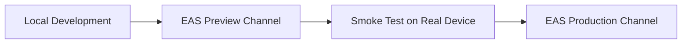

# ZyroBet OTA (Over-The-Air) Playbook

This document defines the OTA release engineering standards, deployment lifecycle, rollback runbooks, and runtime fingerprint guardrails for **ZyroBet** (Expo SDK 57 / React Native 0.86).

---

## 1. Golden Rules of OTA

EAS Update allows delivering instant JavaScript bundle and static asset updates directly to installed applications without going through the Apple App Store or Google Play review process.

### ✅ What CAN Be Shipped via OTA
- React Native JavaScript / TypeScript code changes
- Component styling, colors, animations, and typography
- Static image, audio, font, and Lottie vector assets
- Supabase queries, API client endpoints, and edge function payloads
- Navigation routing logic, state management (Zustand/MMKV keys)
- Bug fixes, UI adjustments, and balance tweaks for mini-games

### ❌ What CANNOT Be Shipped via OTA (Requires New Native Store Binary)
- Installing any new native module (e.g. adding a new CocoaPod / Gradle dependency)
- Modifying `app.config.ts` plugins, permissions, or entitlements
- Changing iOS Info.plist strings (e.g. photo library permission descriptions)
- Changing Android AndroidManifest permissions (e.g. `POST_NOTIFICATIONS`, `VIBRATE`)
- Changing app icons (`icon.png`, `adaptive-icon.png`) or splash screen (`splash.png`)
- Changing URL schemes (`APP_SCHEME`), Associated Domains, or Deep Link App Links
- Changing iOS Bundle Identifier or Android Package Name
- Upgrading Expo SDK or React Native core versions
- Updating `expo-build-properties` (e.g. deployment targets, SDK versions)

> [!CAUTION]
> If any item from the **CANNOT** list is modified, you **MUST create and distribute a new native store binary** using `eas build`. Shipping an OTA update with mismatched native expectations will fail to load or crash on older binaries.

---

## 2. Fingerprint Runtime Protection

ZyroBet configures `runtimeVersion: { policy: "fingerprint" }` in `app.config.ts`.

### How It Works:
1. `@expo/fingerprint` computes a deterministic SHA hash based on all native code, config plugins, package versions, assets, and project configurations.
2. When creating a native binary build (`eas build`), this fingerprint is embedded into the app.
3. When publishing an OTA update (`eas update`), the update is tagged with the exact fingerprint of the repository at publish time.
4. The EAS Update client ensures that an update will **only execute on client binaries whose native fingerprint matches exactly**.
5. If the native code has diverged, the client will safely ignore the update and retain the existing working bundle, preventing runtime crashes.

---

## 3. Pre-Flight OTA Checklist

Before publishing any OTA update:

1. **Verify No Native Drift:**
   ```bash
   npm run fingerprint:check
   ```
   If the fingerprint has changed compared to `docs/fingerprint.baseline.json`, a new native binary build is required!

2. **Run Linter & Typecheck:**
   ```bash
   npm run lint
   npm run typecheck
   ```

3. **Run Unit & Integration Tests:**
   ```bash
   npm test
   ```

4. **Verify Expo Health:**
   ```bash
   npm run doctor
   ```

---

## 4. Deployment Workflow

We use isolated EAS Update channels matching our build profiles:



### Step 1: Deploy to Preview Channel
```bash
npm run update:preview -- --message "Fix tap reflex timing bug"
```

### Step 2: Validate on Test Device
1. Open the internal preview build on a physical iOS/Android device.
2. Go to **Account > Developer Tools > Native Smoke Test** to verify all native modules and OTA channel info.
3. Confirm the update banner appears and changes take effect cleanly.

### Step 3: Promote to Production Channel
```bash
npm run update:production -- --message "Fix tap reflex timing bug - Production Release"
```

---

## 5. Rollback Procedures

If a critical bug or regression is detected in a live production OTA update:

### Method A: EAS Rollback CLI (Recommended)
Roll back to the previous stable update or the embedded binary code:
```bash
# Roll back production channel to previous update
eas update:rollback --channel production
```

### Method B: Republish Previous Git Commit
If you need to roll back to a specific known-good commit:
```bash
git checkout <good-commit-hash>
npm run update:production -- --message "Rollback to commit <good-commit-hash>"
```

---

## 6. Creating Native Development Builds

When native dependencies or plugins change, create fresh development builds using EAS:

### Android:
```bash
eas build --profile development --platform android
```

### iOS:
```bash
eas build --profile development --platform ios
```

Once installed on your device or simulator, start the development server:
```bash
npx expo start --dev-client
```
